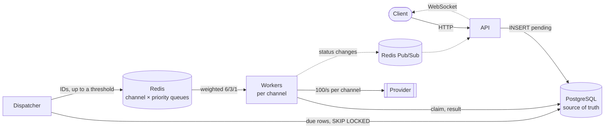

# Notification Service

An event-driven service that accepts SMS, email and push notifications and delivers them
asynchronously through an external provider. It supports:

- priorities and a rate limit of 100 messages per second per channel
- retries with backoff and a circuit breaker
- idempotency, cancellation and batches of up to 1000
- templates and scheduled delivery
- live status updates over WebSocket
- metrics and distributed tracing

Written in Go 1.23 with PostgreSQL, Redis, OpenTelemetry and Jaeger.

- **[docs/DESIGN.md](docs/DESIGN.md)** explains how it works and why, including the mistakes the tests caught.
- **[api/openapi.yaml](api/openapi.yaml)** is the API contract, also served with Swagger UI at `/docs`.

## Quick start

Requires Docker.

```sh
docker compose up --build
```

This needs Docker Compose v2.24 or newer (`docker compose`, not the old Python `docker-compose`
v1), because `.env` is marked optional in `docker-compose.yml`.

To run more worker processes, scale them. The rate limit is shared through Redis, so it stays at
100 messages per second per channel in total:

```sh
docker compose up --build --scale worker=3
```

| What | Where |
|---|---|
| API | http://localhost:8080 |
| API docs (Swagger UI) | http://localhost:8080/docs |
| Delivery snapshot | http://localhost:8080/api/v1/stats |
| Traces (Jaeger) | http://localhost:16686 |
| Worker metrics | http://localhost:9091/metrics (9092 and up for scaled workers) |

Out of the box, notifications go to a bundled **mock provider**, so nothing has to be configured.
To use [webhook.site](https://webhook.site) instead:

1. Create a URL there.
2. Set its response to status `202` with the body `{"messageId": "$request.uuid$", "status": "accepted"}`.
3. Put the URL in `.env`:

```sh
cp .env.example .env   # then set PROVIDER_URL=https://webhook.site/<your-uuid>
docker compose up --build
```

**A free webhook.site URL accepts a limited number of requests in total.** After that it answers
every request with `429` ("Request limit exceeded"), so use a fresh URL for a demo and the mock
provider for load tests. Nothing is lost when it happens: `429` is retried with backoff (honouring
`Retry-After` when present), the circuit breaker stops sending after repeated failures, and
notifications that run out of attempts end as `failed` with the provider's answer in `lastError`.

If a provider limits requests per second across all channels, set `PROVIDER_RATE_LIMIT`. It caps
all channels and worker processes together, and the queue thresholds shrink with it automatically:

```sh
PROVIDER_RATE_LIMIT=5   # in .env
```

## Try it

```sh
API=http://localhost:8080/api/v1

# Create. The Idempotency-Key makes retries safe.
curl -s -X POST $API/notifications -H 'Content-Type: application/json' \
  -H 'Idempotency-Key: order-42-shipped' \
  -d '{"recipient":"+905551234567","channel":"sms","content":"Your order has shipped","priority":"high"}'
# → 202 {"id":"…","status":"pending",…}. Repeat it: 200 with the same id. Change the content: 422.

# Every invalid field at once, including the Turkish SMS limit
# (one ş, ğ or ı makes the limit 70 characters instead of 160).
curl -s -X POST $API/notifications -H 'Content-Type: application/json' \
  -d '{"recipient":"0555","channel":"sms","content":"Şu an kapıda ödeme seçeneğiyle siparişinizi verebilir, ürünlerinizi yarın teslim alabilirsiniz.","priority":"urgent"}'

# A batch: valid items are accepted, invalid ones come back with their reasons.
curl -s -X POST $API/notifications/batch -H 'Content-Type: application/json' -d '{"items":[
  {"recipient":"+905551111111","channel":"sms","content":"Flash sale!","idempotencyKey":"fs-1"},
  {"recipient":"not-an-email","channel":"email","content":"Flash sale!","idempotencyKey":"fs-2"},
  {"recipient":"device-token-abc","channel":"push","content":"Flash sale!","priority":"low","idempotencyKey":"fs-3"}]}'

curl -s $API/batches/<batchId>                    # counts per status
curl -s $API/notifications/<id>                   # one notification
curl -s -X POST $API/notifications/<id>/cancel    # only while pending; 409 otherwise
curl -s "$API/notifications?status=sent&channel=sms&limit=20"   # newest first; pass nextCursor as cursor

# A template, then a notification from it.
curl -s -X POST $API/templates -H 'Content-Type: application/json' \
  -d '{"name":"order_shipped","channel":"sms","body":"Merhaba {{name}}, {{order}} kargoda."}'
curl -s -X POST $API/notifications -H 'Content-Type: application/json' \
  -d '{"recipient":"+905551234567","channel":"sms","templateId":"<templateId>","variables":{"name":"Ayşe","order":"A1"}}'

# Scheduled delivery
curl -s -X POST $API/notifications -H 'Content-Type: application/json' \
  -d '{"recipient":"user@example.com","channel":"email","content":"Good morning","scheduledAt":"2030-01-01T09:00:00Z"}'

# Live updates: a snapshot first, then every status change (any WebSocket client works)
websocat "ws://localhost:8080/api/v1/ws?batchId=<batchId>"

curl -s "$API/stats?window=15m"   # queue depth, success rate, p50/p95 latency per channel
```

### Stage a provider outage

The mock provider can fail on purpose. Watch the retries, the circuit breaker and the recovery:

```sh
MOCK_FAILURE_RATE=0.6 docker compose up -d mockprovider   # 60% of requests answer 503
docker compose logs -f worker | grep -E 'retry|circuit breaker'
MOCK_FAILURE_RATE=0 docker compose up -d mockprovider     # back to healthy
```

`MOCK_STATUS=429` answers everything with 429 and `Retry-After: 2`. `MOCK_LATENCY=500ms` slows every answer.

## How it works



The main decisions are below. [DESIGN.md](docs/DESIGN.md) gives the reasoning for each.

- **PostgreSQL is the source of truth; Redis holds nothing that cannot be rebuilt.** Queues of IDs,
  rate-limit slots and status events. The API writes notifications only to PostgreSQL.
  A dispatcher (transactional outbox) moves due rows into Redis. A crash between "stored" and
  "queued" therefore cannot lose a notification, and neither can a Redis restart.
- **Nothing is lost when a process dies.**
  - A worker that pops an ID and dies before claiming it: the ID is re-queued after a visibility timeout.
  - A worker that dies mid-delivery: its lease expires and the dispatcher releases the notification.
  - A message that keeps crashing workers: it uses up its attempts and fails instead of looping forever.
- **Nothing is claimed twice.** Claim and cancel are single conditional `UPDATE`s. A worker whose
  lease expired cannot overwrite the next owner's result, because the attempt number acts as a
  fencing token.
- **Delivery is at-least-once.** A crash after the provider accepted a message but before the
  result was saved causes one resend. That cannot be avoided across two systems. The provider
  receives `X-Idempotency-Key` so it can drop the duplicate.
- **Redis stays short.** Each queue is filled only up to about 10 seconds of work, and the backlog
  of a burst waits in PostgreSQL.
- **Priority without starvation.** Workers use smooth weighted round-robin (6/3/1), so `low` always
  gets its share.
- **Rate limit.** One limit per channel, shared by every worker process through Redis (a GCRA-style
  slot reservation on Redis's clock), so scaling out does not multiply it. The slot is taken right
  before the provider call. Taking it earlier let the limit be exceeded, and both earlier placements
  were caught by tests.
- **Retries.** Capped exponential backoff with jitter, and `Retry-After` is honoured. 4xx answers
  fail at once, except 408 and 429. A per-channel circuit breaker stops sending to a provider that is down, so messages
  keep their attempts.

## What the tests show

`make test` runs over 150 tests. Integration tests use real PostgreSQL and Redis containers
(testcontainers), not mocks. Some of the results:

| Test | Result |
|---|---|
| 20 concurrent requests with one idempotency key | exactly 1 row created |
| 8 dispatchers taking 300 rows at once | every row taken exactly once |
| 10,000 dequeues under load | exactly 6000 / 3000 / 1000 by priority |
| Burst after idle workers, limit 50/s | at most 51 in any second. An earlier design sent 70, another 54 to 56 |
| 1.5 s provider outage, 30 messages | 11 provider calls with the breaker, 153 without; all 30 delivered |
| `Retry-After: 1` on a 429 | next attempt 1.05 s later |
| Worker A's lease expires, B reclaims, A answers late | A's result rejected, B's kept |
| Template edited, identical request replayed | original returned with 200, not 422 |
| Trace from API to provider | one trace across both processes; the provider gets `traceparent` |
| Every route vs `api/openapi.yaml` | all 17 documented (this test found `/metrics` accepting POST) |

The first CI run found a bug that a 16-CPU laptop hid. The Redis pool was sized by CPU count, and on
a 2-CPU machine the workers blocked on empty queues took every connection
([a857199](../../commit/a857199)).

## Development

```sh
make test        # all tests with the race detector (needs Docker)
make test-short  # unit tests only, no containers
make lint        # golangci-lint, same as CI
make up / down / logs
```

CI (GitHub Actions) runs lint, the tests and a Docker build on every push. On `main` it pushes the
image to `ghcr.io`.

### Configuration

All settings are environment variables with working defaults. The full list is in
[DESIGN.md §11](docs/DESIGN.md#11-configuration). The ones you are most likely to change:

| Variable | Default | |
|---|---|---|
| `PROVIDER_URL` | bundled mock provider | e.g. your webhook.site URL |
| `RATE_LIMIT_PER_CHANNEL` | 100 | messages per second per channel, across all worker processes |
| `PROVIDER_RATE_LIMIT` | 0 (off) | the provider's own requests-per-second limit, shared by all channels |
| `WORKERS_PER_CHANNEL` | 20 | rate × provider latency (Little's law) |
| `PRIORITY_WEIGHTS` | 6,3,1 | high, normal, low |
| `MAX_ATTEMPTS`, `RETRY_BASE`, `RETRY_CAP` | 5, 1s, 5m | |
| `BREAKER_THRESHOLD`, `BREAKER_COOLDOWN` | 5, 30s | |
| `DISPATCH_INTERVAL` | 1s | lower means less latency and more queries |

Unsafe combinations are rejected at startup. For example, a lease shorter than the provider
timeout would let a slow request and its retry run at the same time.

### Layout

```
cmd/api, cmd/worker      the two processes; cmd/mockprovider for local runs
internal/domain          model, state machine, validation (no dependencies)
internal/service         business rules: idempotency, batches, templates
internal/api             HTTP and WebSocket transport
internal/repository      all SQL
internal/queue           Redis priority queues
internal/dispatcher      outbox: PostgreSQL → Redis, lease recovery
internal/worker          rate limit, delivery, retries, circuit breaker
internal/provider        provider HTTP client
internal/events, realtime  status changes → WebSocket clients
migrations/              versioned schema (golang-migrate)
```

## Assessment checklist

| Requirement | Where |
|---|---|
| Create, batch (≤ 1000), query by ID or batch, cancel, list with filters and pagination | `/api/v1/notifications…`, `/api/v1/batches/{id}` |
| Async queue workers, 100 msg/s per channel, priorities, validation, idempotency | DESIGN §4–6 |
| Delivery and retry logic | DESIGN §6–7 |
| Metrics (queue depth, success/failure rates, latency), structured logs with correlation IDs, health | `/api/v1/stats`, `/metrics`, JSON logs, `/healthz`, `/readyz` |
| Bonus: failure handling, scheduling, templates, WebSocket, tracing, CI/CD | all implemented, DESIGN §10 |
| README, `docker compose up`, OpenAPI, migrations, `make test` | this file, `docker-compose.yml`, `api/`, `migrations/`, `Makefile` |

## Known limitations and next steps

- **Latency of the outbox.** A notification waits up to one dispatcher tick (1 s) before it is
  queued. PostgreSQL `LISTEN/NOTIFY` could wake the dispatcher on insert.
- **The rate limiter needs Redis.** If Redis is unreachable, each worker process falls back to its
  own in-process limit, so with N processes the total can reach N × 100/s until Redis is back. In
  practice workers cannot dequeue from Redis either, so little is sent meanwhile.
- **SMS is one segment.** Multi-part SMS (153/67 characters per part) is not supported.
- **`sent` means accepted.** Delivery receipts from the provider would add a `delivered` status.
- **No authentication or tenants.** Idempotency keys are global. With tenants they would be scoped
  per tenant.
- **No retention.** The `notifications` table grows forever. Partitioning by month and archiving
  old partitions would keep it fast.
