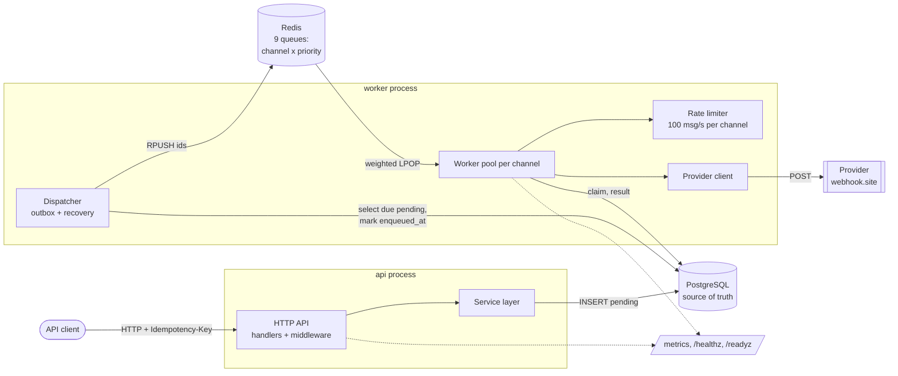
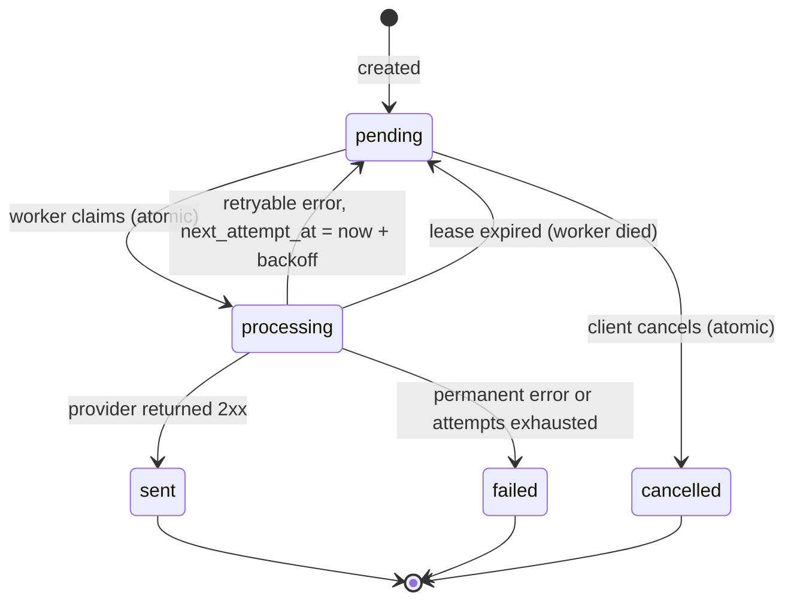
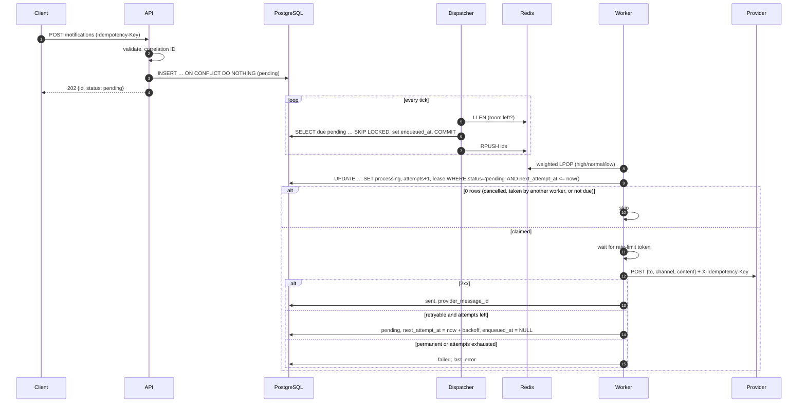
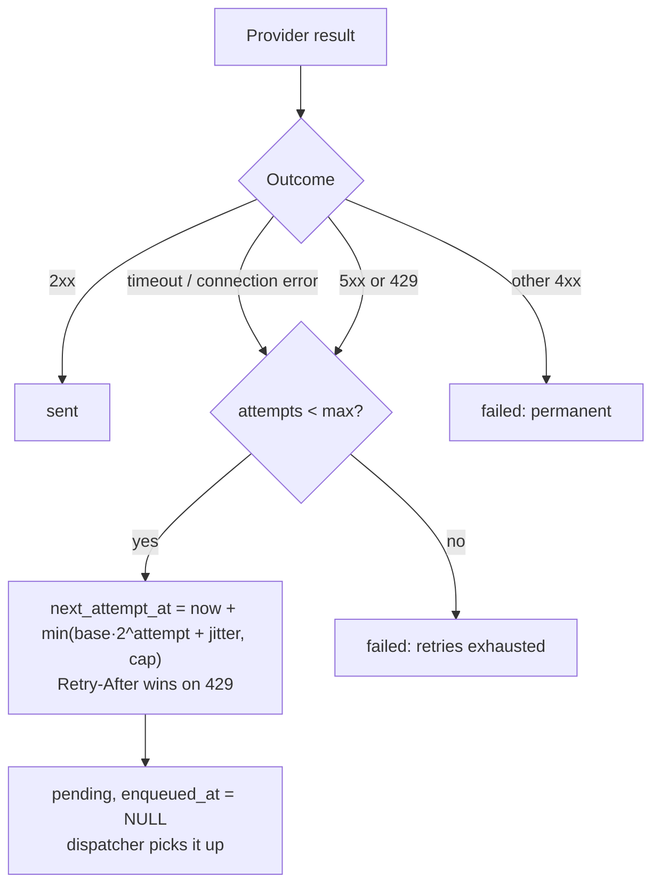
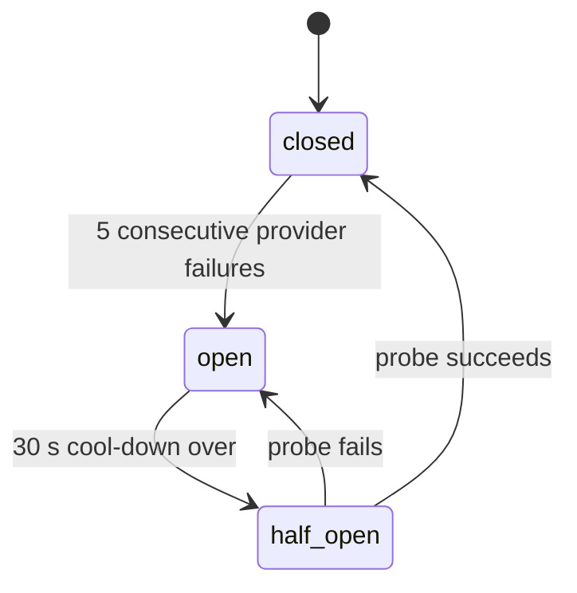
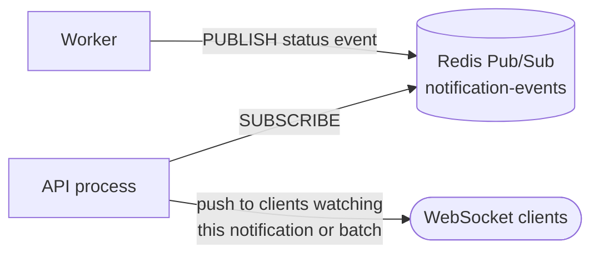

# Design

This document explains how the notification service works and why each decision was made.
Diagrams are written in [Mermaid](https://mermaid.js.org/), which GitHub renders natively.

## 1. Goals and guarantees

The service accepts notification requests (SMS, email, push), stores them, and delivers them
asynchronously through an external provider, with priorities, a rate limit of 100 messages per
second per channel, retries, idempotency, cancellation and status tracking.

Every decision below answers one of two questions:

1. **Where can a notification be lost?**
2. **Where can a notification be sent twice?**

The resulting guarantees:

| Guarantee | How |
|---|---|
| An accepted notification is never lost | PostgreSQL is the source of truth; a dispatcher re-queues anything that is pending but not in the queue (§5) |
| One request creates at most one notification | `Idempotency-Key` + unique index + request hash (§4.2) |
| Delivery is **at-least-once** | A crash after the provider accepted but before the DB update causes one resend; the provider receives `X-Idempotency-Key` so it can drop the duplicate (§6.6) |
| At most 100 messages/s per channel | Token bucket per channel in each worker process (§6.2) |
| High priority goes first, low priority is never starved | Weighted dequeue 6/3/1 (§6.3) and dispatcher fill order (§5.3) |

## 2. System overview



- **PostgreSQL** holds every notification and its state. It is durable and is the only place
  that decides what a notification's status is.
- **Redis** holds only notification IDs in 9 lists (`queue:{channel}:{priority}`). It is a fast
  "what to do next" index. If Redis loses its data, the dispatcher rebuilds the queues from
  PostgreSQL, so nothing is lost.
- **Two binaries**, `api` and `worker`, so the HTTP side and the delivery side scale independently.
  The API never talks to Redis; only the dispatcher writes to the queues.

## 3. Data model

### `notifications`

| Column | Type | Purpose |
|---|---|---|
| `id` | UUID PK | Notification ID, also sent to the provider as `X-Idempotency-Key` |
| `batch_id` | UUID NULL → `batches` | Set when created through the batch endpoint |
| `idempotency_key` | TEXT NULL, unique | Client-supplied key |
| `request_hash` | TEXT NULL | SHA-256 of `(recipient, channel, content, priority, scheduled_at)`; detects key reuse with different content |
| `correlation_id` | TEXT | Request correlation ID (the trace ID), carried into worker logs |
| `traceparent` | TEXT NULL | W3C trace context of the creating request, so the worker can continue the trace (§10.3) |
| `template_id` | UUID NULL → `templates` | Set when the content was rendered from a template |
| `recipient`, `channel`, `content`, `priority` | | The notification itself; `priority` is 0 high, 1 normal, 2 low |
| `status` | TEXT | `pending`, `processing`, `sent`, `failed`, `cancelled` |
| `attempts`, `max_attempts` | INT | Retry counter and limit (default 5) |
| `next_attempt_at` | TIMESTAMPTZ | **The only time the dispatcher looks at.** `now()` on create, `scheduled_at` for scheduled notifications, `now() + backoff` on retry |
| `scheduled_at` | TIMESTAMPTZ NULL | Informational: what the client asked for. Kept because `next_attempt_at` changes on every retry |
| `enqueued_at` | TIMESTAMPTZ NULL | When the dispatcher last pushed it to Redis (§5.2) |
| `lease_expires_at` | TIMESTAMPTZ NULL | Set on claim; if a worker dies, the row becomes recoverable after this time (§5.4) |
| `provider_message_id`, `last_error` | TEXT NULL | Result of the last attempt |
| `created_at`, `updated_at`, `sent_at` | TIMESTAMPTZ | |

### `batches`

`id`, `total`, `accepted`, `rejected`, `created_at`. Lets `GET /batches/{id}` answer without
scanning, and records how many items were rejected at creation time.

### `templates`

`id`, `name` (unique), `channel`, `body`, `created_at`, `updated_at`. The body uses `{{variable}}`
placeholders (§10.1).

### `delivery_attempts`

One row per provider call: `notification_id`, `attempt_no`, `http_status`, `error`,
`duration_ms`, `created_at`. Used for debugging and as the audit trail for failed notifications.

### Indexes

| Index | Used by |
|---|---|
| `UNIQUE (idempotency_key) WHERE idempotency_key IS NOT NULL` | Idempotency |
| `(channel, priority, next_attempt_at) WHERE status = 'pending'` | Dispatcher selection; partial, so it stays small |
| `(lease_expires_at) WHERE status = 'processing'` | Lease recovery |
| `(batch_id)` | Batch status |
| `(created_at DESC, id DESC)`, plus `(status, …)` and `(channel, …)` variants | Listing with filters and keyset pagination |

### State machine



- **`sent`, not `delivered`.** A provider `202` means "accepted", not "the user received it".
  Real delivery would come from a provider callback (delivery report), which this provider does not offer.
- Every transition is a single `UPDATE … WHERE status = '<expected>'`. If it affects 0 rows,
  someone else changed the row first and the caller backs off. That is what makes claim and cancel race-free.

## 4. API

### 4.1 Endpoints

| Method | Path | Result |
|---|---|---|
| `POST` | `/api/v1/notifications` | `202` created, `200` idempotent replay, `400` invalid, `422` key reused with different content |
| `POST` | `/api/v1/notifications/batch` | `202` with per-item results; up to 1000 items |
| `GET` | `/api/v1/notifications/{id}` | Notification with status and attempts |
| `GET` | `/api/v1/batches/{id}` | Batch summary: counts per status |
| `POST` | `/api/v1/notifications/{id}/cancel` | `200` cancelled, `409` already processing or finished, `404` |
| `GET` | `/api/v1/notifications?status=&channel=&from=&to=&limit=&cursor=` | Filtered list, keyset pagination |
| `POST` | `/api/v1/templates` | Create a template: `201`, `409` if the name is taken |
| `GET` | `/api/v1/templates`, `/api/v1/templates/{id}` | List and read templates |
| `PUT` | `/api/v1/templates/{id}` | Replace a template's body |
| `GET` | `/api/v1/stats?window=5m` | Human-readable delivery snapshot (§9) |
| `GET` | `/api/v1/ws?notificationId=` or `?batchId=` | WebSocket stream of status changes |
| `GET` | `/metrics` | Prometheus metrics |
| `GET` | `/healthz`, `/readyz` | Liveness; readiness checks PostgreSQL and Redis |

The full contract is in `api/openapi.yaml`.

### 4.2 Idempotency

```sql
INSERT INTO notifications (…) VALUES (…)
ON CONFLICT (idempotency_key) WHERE idempotency_key IS NOT NULL DO NOTHING
RETURNING *;
```

- A new key inserts the row and returns it: `202`.
- On conflict, `RETURNING` is empty, so the service reads the existing row with a `SELECT`. This is
  safe because the unique index, not the service, decides who wins.
  - Same key, same `request_hash` → return the existing notification: `200`.
  - Same key, different `request_hash` → `422`: the client reused a key for a different request (same rule as Stripe).
- Keys are global because the service has no authentication. With tenants, the unique index would be `(tenant_id, idempotency_key)`.

### 4.3 Validation

| Field | Rule |
|---|---|
| `channel` | `sms`, `email` or `push` |
| `priority` | `high`, `normal`, `low`; default `normal` |
| `recipient` | SMS: E.164 phone (`+905551234567`). Email: valid address. Push: device token (non-empty, max 4096 chars) |
| `content` | Required unless `templateId` is given; then it is the rendered template. SMS: one segment, 160 characters in GSM-7, **70** if any character is outside GSM-7 (UCS-2). Email: max 100 KB. Push: max 4 KB (APNs/FCM payload limit) |
| `scheduledAt` | Optional, must be in the future |

Turkish SMS note: `ş Ş ğ Ğ ı İ` are not in GSM-7, so one of them makes the limit 70. `ö ü Ö Ü Ç`
are in GSM-7; lowercase `ç` is not, but most gateways map it to `Ç`. The 3GPP Turkish single-shift
table can keep `ş ğ ı` in GSM-7 (about 155 characters), but it depends on operator support, so the
service applies the plain 160/70 rule.

### 4.4 Batch

**Partial acceptance:** valid items are accepted, invalid ones are returned with a reason. Rejecting
999 good messages because one phone number is wrong would be worse for the client.

- Each item may carry its own `idempotencyKey`.
- All accepted items are inserted in one transaction.
- Response: `batchId`, `accepted`, `rejected`, and a result per item (`index`, `id` or `error`).

## 5. Dispatcher (outbox)

### 5.1 The problem: dual write

Writing to PostgreSQL and pushing to Redis are two separate systems. If the process crashes between
them, or Redis is down, the row stays `pending` but no worker ever sees it. The notification is
silently lost.

**Solution: transactional outbox.** The API only writes to PostgreSQL. A dispatcher loop in the
worker process moves due `pending` rows into Redis. The same loop also handles retries whose
backoff has passed, scheduled notifications whose time has come, and lease recovery.

### 5.2 Selection and the visibility timeout

`enqueued_at` stops the dispatcher from pushing the same row on every tick. But consider this case:
a worker pops an ID from Redis (now gone from Redis) and crashes before claiming it. The row is
still `pending` with `enqueued_at` set, so the dispatcher thinks it is queued. **The notification is lost.**

The fix is the same idea as the SQS visibility timeout: a row that was enqueued long ago and is
still pending is enqueued again.

```sql
SELECT id FROM notifications
WHERE status = 'pending'
  AND channel = $1 AND priority = $2
  AND next_attempt_at <= now()
  AND (enqueued_at IS NULL OR enqueued_at < now() - $visibility_timeout)
ORDER BY next_attempt_at
FOR UPDATE SKIP LOCKED
LIMIT $room;
```

Steps per tick, for each channel and each priority in the order high → normal → low:

1. `room = threshold − LLEN(queue)`. If `room ≤ 0`, skip this queue (backpressure, §5.3).
2. In one transaction: run the query above, set `enqueued_at = now()` on the selected rows, commit.
3. After commit, `RPUSH` the IDs to Redis.

If the process dies between step 2 and step 3, the IDs never reach Redis, but `enqueued_at` is set.
The visibility timeout picks them up again later, so this case needs no special handling.

`FOR UPDATE SKIP LOCKED` lets several dispatchers run at once without selecting the same rows.

**Enqueuing the same ID twice is harmless.** The claim (§6.5) only succeeds for a `pending` row,
so the second worker affects 0 rows and skips it. `enqueued_at` is an optimisation; correctness does not depend on it.

### 5.3 Backpressure: keep Redis short, let the backlog wait in PostgreSQL

Without a limit, a burst of 50,000 messages would sit in Redis for about 8 minutes (at 100 msg/s).
Every message older than the visibility timeout would look lost and be re-enqueued on each tick,
filling the queue with its own duplicates.

So the dispatcher fills each queue only up to a threshold. The backlog waits in PostgreSQL, which
is durable anyway. Because queues are filled high first, freed room goes to high priority first.

**Threshold = target wait (10 s) × drain rate of that queue under load.** With 100 msg/s and
weights 6/3/1:

| Queue | Drain rate under load | Threshold |
|---|---|---|
| high | 60 msg/s | 600 |
| normal | 30 msg/s | 300 |
| low | 10 msg/s | 100 |

Each queue drains in about 10 s. `VISIBILITY_TIMEOUT` defaults to 5 minutes, roughly 30× that.
Rule: `VISIBILITY_TIMEOUT ≫ threshold / slowest drain rate`.

### 5.4 Lease recovery

On each tick the dispatcher also runs:

```sql
UPDATE notifications
SET status = 'pending', enqueued_at = NULL, lease_expires_at = NULL
WHERE status = 'processing' AND lease_expires_at < now();
```

A worker that died mid-delivery leaves its row in `processing`. After the lease expires, the row
goes back to `pending` and is delivered again (this is where at-least-once comes from, §6.6).
`LEASE_DURATION` (default 30 s) must be longer than the provider HTTP timeout (default 5 s).

## 6. Worker

### 6.1 Lifecycle of one message



### 6.2 Order: dequeue, claim, then token

The rate-limit token is taken **right before the provider call**, after the claim. Two earlier
placements were tried and tests rejected both:

1. **Token before dequeue.** Idle workers each took a token and then blocked on an empty queue for
   up to a second. When a burst arrived, the saved tokens were spent at once on top of the bucket's
   rate: 70 requests in one second against a limit of 50.
2. **Token between dequeue and claim.** This passed on a quiet machine. Under load,
   `TestRateLimitHoldsAfterIdle` saw 52 to 55 requests per second. The claim query between the token
   and the request takes 5 ms for one worker and 50 ms for another, so evenly spaced tokens turned
   into bunched requests.

That placement was originally chosen out of fear that a claimed message waiting for a token would
outlive its lease. The fear was unfounded. A worker waits only for the other workers of its channel
(`workers / rate = 20 / 100 = 0.2 s`), not for the queue, and the lease is 30 s. With the token
immediately before the request, the busiest second stays at 51 (limit plus a burst of 1). Under
heavy load with the race detector it occasionally shows 52. That comes from timer wake-ups that run
late, not from extra tokens, and the test allows two requests for it. As a side benefit, a failed claim no longer wastes a token.

The limiter is `golang.org/x/time/rate`, one token bucket per channel (100/s, burst 1), shared by
all workers of that channel in the process. It is in memory, so two worker processes would allow
200/s in total. Scaling out would need a Redis-based limiter. This is documented as a known limitation.

### 6.3 Weighted priority

Strict priority would starve `low` during a long burst. Workers instead follow a weighted
round-robin of 6/3/1 (high/normal/low). If the chosen queue is empty, they fall through to the others in
priority order. If all are empty, they block on `BLPOP` across the three queues for up to 1 s.

### 6.4 Pool size

Each channel has its own pool, so a slow email provider cannot block SMS. Pool size comes from
Little's law: `workers = rate × latency = 100/s × ~0.2 s ≈ 20`. The default is 20 per channel, configurable.

### 6.5 Claim conditions and fencing

The claim is one `UPDATE … WHERE id = $1 AND status = 'pending' AND next_attempt_at <= now()`.
It increments `attempts` and sets the lease. Each condition closes one race:

- `status = 'pending'`: a cancelled notification, or one another worker already claimed, is skipped.
- `next_attempt_at <= now()`: the visibility timeout can leave a second copy of an ID in Redis. If
  the first copy failed and was rescheduled for a later retry, the stale copy must not send it early.

Counting the attempt at claim time means a worker that crashes still uses up an attempt. When the
dispatcher recovers an expired lease with no attempts left, the notification fails instead of
crashing workers forever.

The `attempts` value returned by the claim also works as a **fencing token**. Worker A's lease can
expire while the provider is slow, and worker B can claim the notification again (`attempts` becomes 2).
When A's answer finally arrives, A writes its result with `WHERE attempts = 1`, matches nothing, and
backs off (`ErrLeaseLost`). A late worker can never overwrite the current owner's result. Both
provider calls are still recorded in `delivery_attempts`.

On shutdown a worker stops taking new messages but finishes a delivery already in flight.
Abandoning it halfway would only cause a resend once the lease expires.

### 6.6 Delivery guarantee: at-least-once

If the provider accepts a message and the worker dies before writing `sent`, the lease expires and
the message is sent again. This cannot be fully prevented: the provider call and the database update
are two systems that cannot be updated atomically, so a system must choose between at-least-once
and at-most-once. We choose **at-least-once**, because a lost notification is invisible while a duplicate can be filtered.

To help, every provider request carries `X-Idempotency-Key: <notification id>`. A provider that
supports it drops the duplicate. The request body stays `{to, channel, content}` as required.

### 6.7 Cancellation

```sql
UPDATE notifications SET status = 'cancelled' WHERE id = $1 AND status = 'pending';
```

0 rows means the notification is already in flight or finished: `409`. A cancelled ID may still be
in Redis; the worker's claim fails and it is skipped.

## 7. Retry policy



| Setting | Default | Why |
|---|---|---|
| `base` | 1 s | |
| exponential growth | `base × 2^attempt` | Gives a struggling provider room to recover |
| jitter | random in `[0, base × 2^attempt)` | Stops thousands of failed messages from retrying in the same second |
| `cap` | 5 min | Without it the 10th attempt would wait about 17 minutes |
| `max_attempts` | 5 | |
| `Retry-After` on 429 | honoured | The provider knows its own limit |

Failed notifications keep their full history in `delivery_attempts`, so they act as a dead-letter
record that can be inspected or re-driven.

`Retry-After` is bounded to one hour, so a broken header cannot park a notification for days.
A shorter `Retry-After` does not shorten our own backoff.

### Circuit breaker (failure handling bonus)

Each channel has a breaker with three states:



- **What counts as a failure:** 5xx, 429, timeouts and connection errors, meaning the provider is
  struggling. A 400 does not count: the provider answered, and the message is the problem.
- **Open:** the channel's workers stop popping. Messages wait in Redis and PostgreSQL **with their
  attempts untouched**, so an outage longer than the retry budget does not fail them all.
- **Half-open:** exactly one probe goes through, however many workers are waiting. A worker that
  started before the breaker opened cannot close it with a late success: only the probe decides.

`TestBreakerShieldsAProviderThatIsDown` runs 30 messages through a 1.5 s outage. Without the
breaker the provider received 153 requests and each message spent about five of its attempts. With
it the provider received 11, and every message was delivered once the provider came back.

## 8. Listing: keyset pagination

`OFFSET 100000` makes PostgreSQL read and discard 100,000 rows. Pages also shift when new rows
arrive, so a client can see a row twice or miss one. Instead, the cursor encodes the last
`(created_at, id)` seen:

```sql
WHERE (created_at, id) < ($cursor_created_at, $cursor_id) [AND filters]
ORDER BY created_at DESC, id DESC
LIMIT $limit;
```

With the index on `(created_at DESC, id DESC)`, every page costs the same.

## 9. Observability

| Endpoint | Process | For | Content |
|---|---|---|---|
| `GET /api/v1/stats?window=5m` | api | people | JSON per channel: queue depth, pending, processing, sent and failed in the window, provider success rate, p50/p95 provider latency and end-to-end latency |
| `GET /metrics` | api `:8080`, worker `:9091` | Prometheus | Counters and histograms (below) |
| `GET /healthz` | both | liveness | Always 200 while the process runs. Restarting would not fix a database outage, so no dependency is checked |
| `GET /readyz` | both | readiness | Pings PostgreSQL and Redis; 503 naming the failing one |

`/metrics` is for machines and `/api/v1/stats` is for people. Prometheus computes rates over time from
counters, which a person reading raw counters with `curl` cannot do.

Prometheus metrics:

- API:
  - `http_request_duration_seconds{method, route, status}`. The route label is the pattern
    (`/api/v1/notifications/{id}`), so the number of series stays bounded.
  - `notifications_created_total{channel, priority}` (idempotent replays excluded).
- Worker:
  - `delivery_attempts_total{channel, outcome}` with outcome `sent`, `retry` or `failed`.
  - `provider_request_duration_seconds{channel}`.
  - `notification_delivery_seconds{channel, priority}`: created to sent, including queueing and retries.
  - `circuit_breaker_state{channel}`: 0 closed, 1 half-open, 2 open.
  - `dispatcher_enqueued_total`, `dispatcher_leases_recovered_total`, `dispatcher_leases_exhausted_total`.
- Both: `notification_queue_depth{channel, priority}`, read from Redis at scrape time.

**Logs** are JSON (`log/slog`). Every request gets a correlation ID, taken from `X-Correlation-ID`
or generated. It is stored on the notification, so worker log lines for that notification carry the
same ID. Health and metrics requests are not logged.

**Latency of the outbox.** End-to-end latency includes the wait for the next dispatcher tick: up to
`DISPATCH_INTERVAL` (1 s), about 0.9 s at p50 in a local run against webhook.site. A shorter interval
trades a few more indexed queries for lower latency. PostgreSQL `LISTEN/NOTIFY` could wake the
dispatcher on insert and remove the wait almost entirely.

## 10. Bonus features

| Bonus | Where |
|---|---|
| Failure handling | Retry policy, dead-letter record and circuit breaker (§7) |
| Scheduled notifications | `scheduledAt` becomes the first `next_attempt_at`; the dispatcher does the rest (§5) |
| Template system | §10.1 |
| WebSocket updates | §10.2 |
| Distributed tracing | §10.3 |
| GitHub Actions CI/CD | §10.4 |

### 10.1 Templates

A request may send `templateId` and `variables` instead of `content`. The body
`Hi {{name}}, your order {{order}} is on its way` is rendered **when the notification is created**,
and the result is stored as `content`. This has three effects:

- Validation (for example the SMS 160/70 limit) runs on the final text.
- The worker does not need to know about templates.
- Editing a template later does not change notifications that are already queued.

A missing variable, a template for a different channel, sending both `content` and `templateId`, or
a text that is too long once rendered is a `400`. A body with a malformed placeholder (`{{name` or
`{{ 1x }}`) is rejected when the template is created, not when it is used.

The renderer only substitutes `{{name}}` placeholders. There is no logic and no code execution, so a
template author cannot make the service do anything else. Values are inserted as plain text and never
expanded again, so a value of `{{order}}` stays literally `{{order}}`.

**Idempotency with templates.** For a template request, the request hash covers what the client
sent, `templateId` and `variables`, not the rendered text. Suppose a template is edited between a
request and its retry. If the hash covered the rendered text, the identical retry would look like
"same key, different content" and get a `422`. Hashing the request instead returns the original
notification with `200`. `TestNotificationFromTemplate` checks this case and also checks that the
existing notification keeps its original text after the edit.

Within a batch, each template is read once, however many items use it.

### 10.2 WebSocket status updates

Status changes happen in the worker process, but WebSocket clients are connected to the API
process. The two are joined with **Redis Pub/Sub**:



Every state transition (claim, sent, retry, failed, cancel) publishes
`{id, batchId, status, attempts, at}`. The API keeps an in-memory map from notification and batch IDs
to connected clients. Pub/Sub is fire-and-forget: a client that disconnects misses events. That is
acceptable because PostgreSQL stays the source of truth: on reconnect, the client reads the current
state with `GET` and then follows the stream.

### 10.3 Distributed tracing

OpenTelemetry spans are exported to Jaeger (included in `docker-compose`). The trace must follow a
notification across the asynchronous gap:

`HTTP request → INSERT → (dispatcher) → worker claim → provider call`

The dispatcher breaks the in-process context, so the creating request's W3C `traceparent` is stored
on the row. The worker restores it and starts its delivery span as a child. The provider request also
carries the `traceparent` header. The trace ID doubles as the correlation ID, so a log line and a trace
can be matched with one ID.

### 10.4 CI/CD

GitHub Actions on every push and pull request:

1. `golangci-lint`
2. `go test -race ./...` (integration tests use testcontainers for PostgreSQL and Redis)
3. Build the Docker image; on `main`, push it to GitHub Container Registry.

## 11. Configuration

| Variable | Default |
|---|---|
| `RATE_LIMIT_PER_CHANNEL` | 100 |
| `WORKERS_PER_CHANNEL` | 20 |
| `PRIORITY_WEIGHTS` | 6,3,1 |
| `QUEUE_THRESHOLDS` | 600,300,100 |
| `DISPATCH_INTERVAL` | 1s |
| `VISIBILITY_TIMEOUT` | 5m |
| `LEASE_DURATION` | 30s |
| `PROVIDER_TIMEOUT` | 5s |
| `RETRY_BASE`, `RETRY_CAP`, `MAX_ATTEMPTS` | 1s, 5m, 5 |
| `BREAKER_THRESHOLD`, `BREAKER_COOLDOWN` | 5, 30s |
| `PROVIDER_URL` | webhook.site URL |
| `METRICS_ADDR` | :9091 (worker) |
| `OTEL_EXPORTER_OTLP_ENDPOINT` | Jaeger collector |

## 12. Code layout

| Layer | Package | Responsibility | Must not |
|---|---|---|---|
| Domain | `internal/domain` | Entities, status enum, validation, errors | Import any other layer |
| Transport | `internal/api` | HTTP parsing, status codes, middleware | Contain business rules or SQL |
| Service | `internal/service` | Idempotency, batch, cancel rules | Know about HTTP or SQL |
| Repository | `internal/repository` | All SQL | Make business decisions |
| Queue | `internal/queue` | Redis lists behind an interface | Know what a notification means |
| Dispatcher | `internal/dispatcher` | Outbox, backpressure, lease recovery | Call the provider |
| Worker | `internal/worker` | Rate limit, dequeue, claim, deliver, retry | Parse HTTP requests |
| Provider | `internal/provider` | HTTP client for the provider | Touch the database |
| Events | `internal/events` | Publish and subscribe status events (Redis Pub/Sub) | Decide status |
| Realtime | `internal/realtime` | WebSocket hub: clients and subscriptions | Read the database |

Dependencies point inward. Interfaces are declared where they are used, so each layer is tested with fakes.

| Pattern | Where | Why |
|---|---|---|
| Transactional outbox | dispatcher | Survive the PostgreSQL/Redis dual write |
| Repository | DB access | Swappable and mockable storage |
| Dependency injection | `cmd/*/main.go` | No globals, easy tests |
| Strategy | provider per channel | Add a channel without touching the worker |
| Producer–consumer, worker pool | dispatcher → workers | Bounded concurrency |
| Token bucket | rate limiter | 100 msg/s with small bursts |
| Middleware | correlation ID, logging, recovery | Cross-cutting concerns outside handlers |
| State machine | notification status | Only valid transitions, enforced in SQL |
| Circuit breaker | provider client | Stop hammering a provider that is down |
| Publish–subscribe, observer | status events → WebSocket hub | Decouple the worker from connected clients |

## 13. Alternatives considered

- **PostgreSQL as the only queue** (`SELECT … FOR UPDATE SKIP LOCKED` in workers): fewer moving
  parts and no dual write. Rejected because the brief asks for queue workers and priority queues,
  and Redis keeps the dequeue hot path off the database under burst traffic. The outbox keeps
  PostgreSQL as the source of truth, so Redis adds speed without adding a way to lose data.
- **API pushes to Redis directly** after the insert: lower latency, but loses messages on a crash
  between the two writes. The dispatcher closes that gap at the cost of up to one tick of delay.
- **Offset pagination**: simpler, but slow on deep pages and unstable while data changes.
- **Rendering templates in the worker**: would let a template edit affect queued messages and would
  move validation after acceptance, so a too-long SMS would fail late instead of returning `400`.
- **Redis Streams instead of Pub/Sub for WebSocket events**: replayable, but heavier. Clients can
  recover state with `GET`, so losing an event is harmless.

## 14. Known limitations

- At-least-once delivery: a crash at the wrong moment sends a notification twice (§6.6).
- The rate limiter is per process; multiple worker processes need a shared (Redis) limiter.
- SMS is limited to a single segment; multi-part SMS (153/67 characters per part) is not supported.
- No delivery receipts: `sent` means accepted by the provider.
- WebSocket events are best-effort (Pub/Sub); the WebSocket hub is per API process, which is fine
  because every API process subscribes to the same Redis channel.
